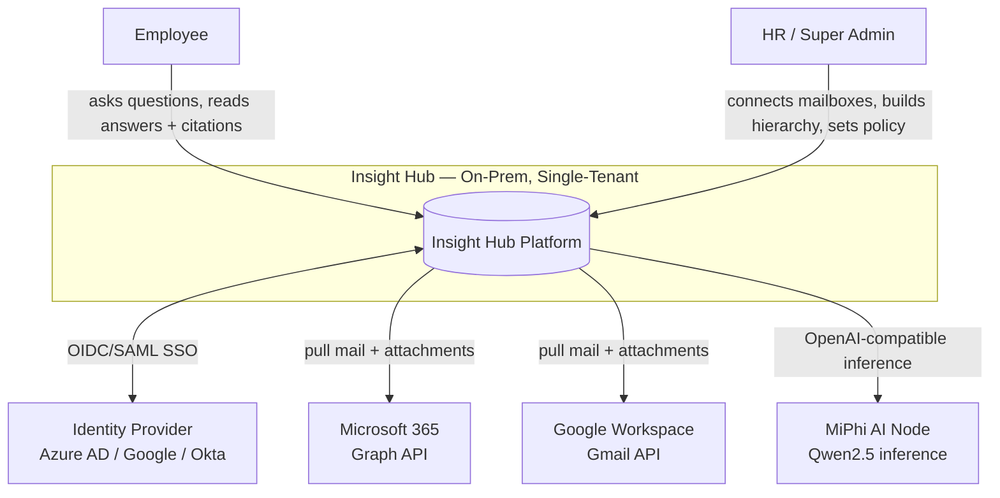
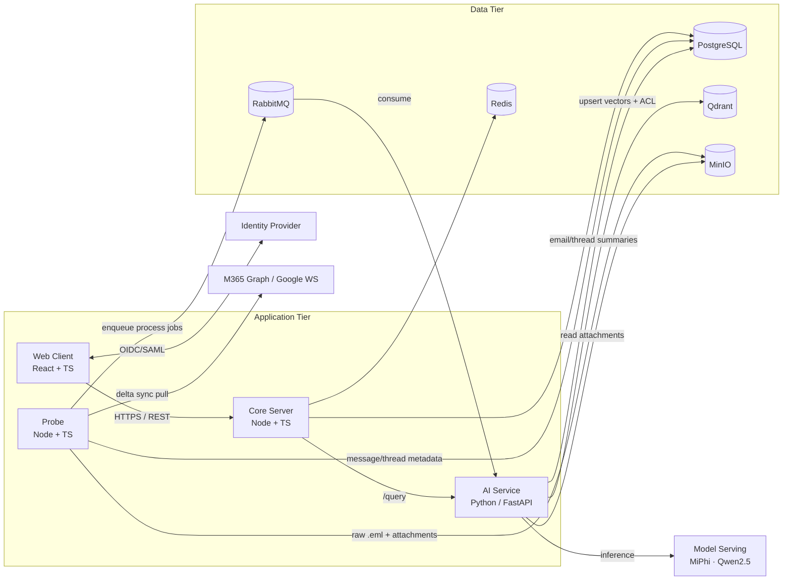

# 01 — Architecture

Insight Hub is an **on-premise, single-tenant business intelligence platform**. Email is its first
production source module; the architecture is intended to grow into accounting, document,
inventory/CRM, and MCP-connected sources without weakening provenance or access control. This
document describes the currently implemented email analysis architecture.

---

## 1. System Context (C4 Level 1)

**Actors**
- **Employee** — asks questions; sees only permitted knowledge, with citations.
- **HR / Super Admin** — bootstraps the system, connects mailboxes, builds the org hierarchy tree,
  sets retention/policy, configures SSO, reviews audit logs.

**External systems**
- **Identity Provider** (Azure AD / Google / Okta) via OIDC/SAML for employee SSO.
- **Microsoft 365 (Graph)** and **Google Workspace (Gmail)** as email sources.
- **MiPhi AI node** running the local LLM behind an OpenAI-compatible API.

---

## 2. Container View (C4 Level 2)

---

## 3. Component responsibilities

### Web Client (React + TypeScript)
- **Chat experience**: question box, streamed grounded answers, **citation cards**, document preview.
- **Admin Console**: onboarding wizard, mailbox connection, **org-hierarchy tree builder**,
  retention/policy settings, **sync dashboard**, audit viewer, mailbox-metering view.

### Core Server (Node + TypeScript) — the trust boundary
- **Authentication**: native bootstrap login + **OIDC/SAML SSO**; sessions; break-glass admin.
- **Permission Resolver**: computes the asker's **reporting-chain scope** (set of mailbox owner IDs)
  via a Postgres recursive CTE; produces the ACL filter handed to retrieval. **This is the security
  decision point** — never the LLM.
- **Query Orchestrator**: validates request, attaches ACL filter, calls AI Service, returns answer +
  permission-checked document links.
- **Audit writer** and **per-mailbox metering/licensing**.
- **Admin APIs**: hierarchy CRUD, mailbox connect, policy, audit, metering.

### Probe (Node + TypeScript) — ingestion
- **Sync scheduler**: backfill + scheduled incremental (Graph delta / Gmail `historyId`).
- **Worker pool / job splitting**: distributes mailbox jobs across workers (e.g., 50 → 5×10) via BullMQ.
- **Connectors**: Microsoft Graph (app `Mail.Read`), Google Workspace (domain-wide delegation).
- **Dedup**: RFC `Message-ID` + content hash against Postgres → never re-download/re-embed.
- Writes raw `.eml` + attachments to MinIO; metadata to Postgres; emits process jobs to RabbitMQ.

### AI Service (Python / FastAPI) — the RAG brain
- **Document parsing** (unstructured + Apache Tika), **OCR** (PaddleOCR), **language detection**.
- **Chunking** + **embedding** (BGE-M3) → upsert to Qdrant with ACL payload.
- **Summarization**: per-email → incremental **thread** rollups.
- **Retrieval**: hybrid (BM25 + dense) → **RRF fusion** → **cross-encoder rerank**.
- **Generation**: builds the grounded, injection-hardened prompt; calls MiPhi; applies **guardrails**
  and output filtering.

### Model Serving (MiPhi)
- **Qwen2.5-Instruct** on the dedicated AI VM/chip, exposed via an **OpenAI-compatible HTTP API** so
  the runtime is swappable (GPU fallback for development).

---

## 4. Cross-cutting concerns

| Concern | Where it lives |
|---|---|
| **Authorization** | Core Server Permission Resolver + Qdrant ACL filter (outside the model) |
| **Audit** | Append-only `audit_log` in Postgres; written by Core Server + Probe + AI Service |
| **Prompt-injection defense** | AI Service prompt construction + output filtering (see [05](05-security-design.md)) |
| **Caching** | Redis (hot summaries, query results, sessions) |
| **Async work** | RabbitMQ (Probe → AI) + BullMQ/Redis (Probe internal job fan-out) |
| **Config & secrets** | Postgres (encrypted) / optional external vault |
| **Observability** | Structured logs, metrics, sync dashboard, job/queue depth |

---

## 5. Architectural principles
1. **The LLM is never the security boundary.** All access control is enforced in Postgres/Qdrant.
2. **RAG over training.** Knowledge stays external, fresh, auditable, and deletable.
3. **Idempotent ingestion.** Message-ID dedup makes re-runs safe and cheap.
4. **Polyglot by fit.** Node for I/O-bound services; Python for the ML tier.
5. **Swappable model runtime.** OpenAI-compatible abstraction insulates us from MiPhi specifics.
6. **Design once for the product, switch on by tier.** Single-node MVP and HA k3s share one design.

See [02 — System Design](02-system-design.md) for the detailed data flows.
