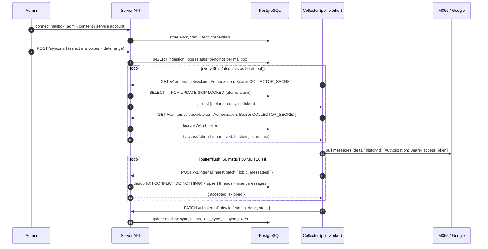
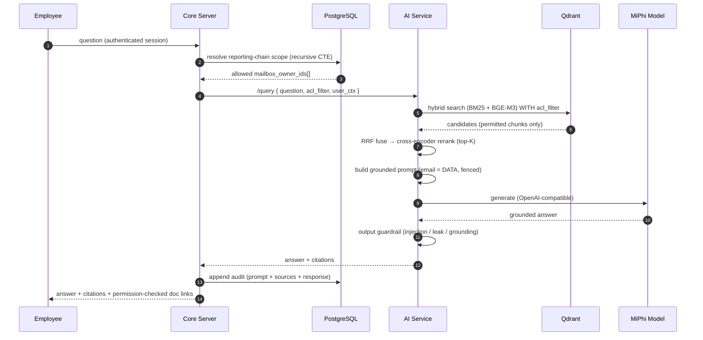
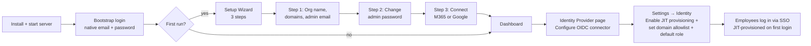
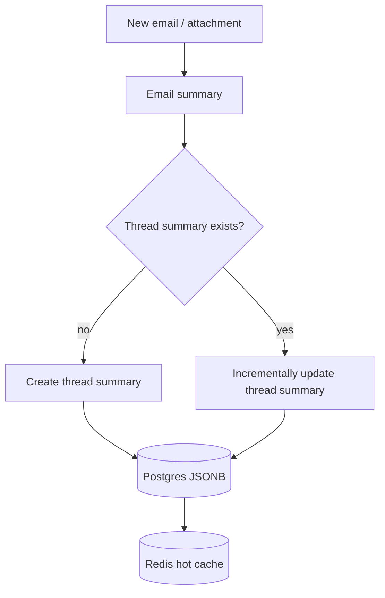

# 02 — System Design

Detailed data flows, synchronization, de-duplication, and the summarization pipeline.

---

## 1. Ingestion (write path)

> **Architecture**: Server is the single source of truth. Collector is a stateless poll-worker — no direct DB access, no message broker. All persistence goes through the Server API.

### Stages
1. **Connect** — admin connects a source; tokens AES-256 encrypted at rest in Postgres.
2. **Create jobs** — `POST /sync/start` inserts one `ingestion_jobs` row per sync-enabled mailbox.
3. **Claim** — Collector polls every 30 s; server atomically claims up to N jobs via `SELECT … FOR UPDATE SKIP LOCKED`.
4. **Token fetch** — Collector calls a dedicated `/token` endpoint per job just before calling the provider. Token never travels in the claim response.
5. **Fetch** — M365 Graph delta API (deltaToken) or Gmail history API. Incremental if `syncToken` exists, else backfill from `syncFromDate`.
6. **Buffer/flush** — Collector accumulates messages in memory; flushes to server on 50 msgs OR 50 MB OR 10 s elapsed.
7. **Dedup + persist** — Server uses `INSERT … ON CONFLICT DO NOTHING` on `providerMessageId + mailboxId`. Upserts threads.
8. **Complete** — Collector patches job status; server updates mailbox counters and `syncToken` for next incremental run.
9. **Stale recovery** — Server cron runs every 2 min; resets jobs stuck in `claimed` > 5 min back to `pending`.

> Phase 2 adds MinIO for raw `.eml` + attachment storage. Phase 3 adds RAG indexing (Qdrant + Ollama).

---

## 2. Query (read path) — security-critical

### Two enforced invariants
- **ACL filter applied in Qdrant (step 4).** Out-of-scope chunks are never retrieved, so they can
  never reach the model. A filter bug — not the model — is the only theoretical leak path, which is
  why permission resolution is centralized and tested hard.
- **Retrieved email is fenced as DATA (step 7).** Instructions embedded in email bodies are never
  executed (indirect prompt-injection defense — see [05](05-security-design.md)).

---

## 3. Authentication & onboarding flow

### Actual flow (Phase 0 + Phase 1 — live)

### Full target flow (all phases)

```mermaid
flowchart LR
  A[Install .run bundle] --> B[Bootstrap Super Admin\nnative login]
  B --> C[Setup Wizard]
  C --> D[Connect M365 / Google\nadmin consent / DWD]
  D --> E[Build org hierarchy tree\nPhase 2]
  E --> F[Set retention + sensitive policy\nPhase 4]
  F --> G[Start backfill ingestion\nwatch sync dashboard\nPhase 1]
  G --> H[Configure OIDC SSO\nDone]
  H --> I[Enable JIT provisioning\nDone]
  I --> J[Employees log in via SSO\nautomatically provisioned]
```

- The native Super Admin remains a permanent **break-glass** account (MFA — Phase 4) even after SSO is configured.
- OIDC (Microsoft 365 + Google) and JIT provisioning are live. SAML is planned for Phase 4.
- Employee identities are JIT-provisioned from the IdP. Org hierarchy mapping is Phase 2.

---

## 4. Synchronization model

| Aspect | MVP | Pilot / GA |
|---|---|---|
| Initial load | Bulk **backfill** | Same |
| Ongoing | **Scheduled incremental** (Graph delta / Gmail `historyId`) | + **near-real-time push** where allowed |
| Gap recovery | Periodic full reconcile | **Reconciliation sweep** on schedule |
| Why polling-first | On-prem customers often block inbound webhooks | Push added only when network allows |

**Dedup key:** `Message-ID` (immutable) + content hash. Delta/history tokens persisted per mailbox so
each run fetches only new items.

---

## 5. Summarization pipeline (hierarchical, incremental)

**Rules (cost control — see risk R6):**
- Summarize **once on ingest**; **re-summarize a thread only when it changes**.
- The background job is reserved for **backfill** and **post-model-upgrade reprocessing**, with explicit
  triggers/stop-conditions — never an open-ended "keep enhancing" loop.
- **Permission scoping (risk R5):** thread summaries that blend content across people must be scoped to
  what each viewer may see; cross-org threads use per-viewer scoping so summaries never leak content.

---

## 6. Retrieval design

- **Hybrid**: BM25 keyword + dense BGE-M3 vectors.
- **Fusion**: Reciprocal Rank Fusion (RRF) over the two result sets.
- **Rerank**: cross-encoder over top candidates for precision.
- **Why hybrid**: the flagship query needs exact tokens ("ABC company") *and* semantic intent
  ("update / what happened") — neither method alone suffices.

---

## 7. Retention & deletion

- Admin-configured retention window. A retention worker purges expired data **across all stores**
  (Postgres rows, Qdrant vectors, MinIO blobs, summaries, caches) in a single **cascade**.
- Same cascade supports per-mailbox / per-person purge (privacy, future right-to-delete).
