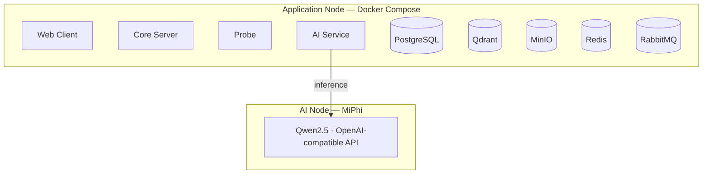
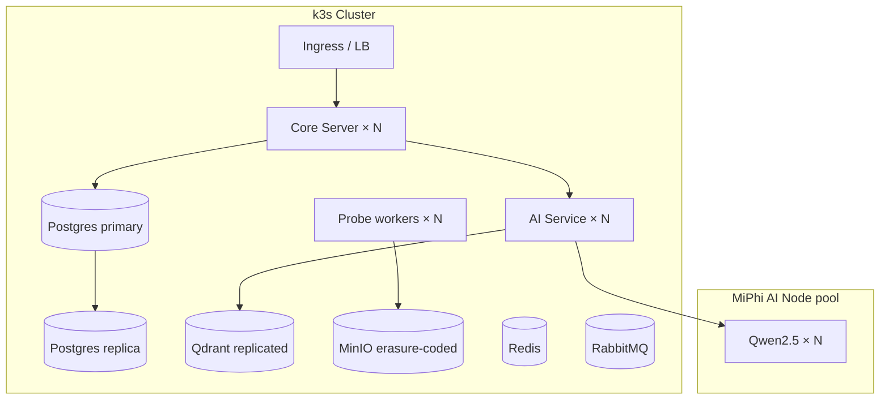
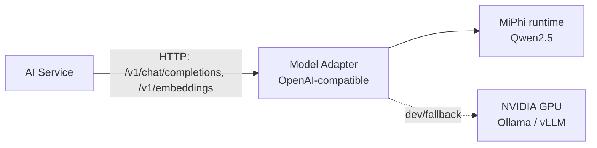

# 06 — Infrastructure Design

On-premise, single-tenant. One design, switched on by tier: **single-node MVP** → **HA k3s pilot/GA**.

---

## 1. Topology

### MVP — single node (Docker Compose)

### Pilot / GA — HA cluster (k3s)

The **MiPhi AI node(s)** are separate from the app cluster (dedicated accelerator hardware), reached
only through the OpenAI-compatible API.

---

## 2. MiPhi serving abstraction

- All model calls go through an **OpenAI-compatible interface**, so the concrete runtime (MiPhi SDK,
  or GPU Ollama/vLLM for development) is swappable with **zero changes** to the AI Service.
- **Open action:** obtain MiPhi SDK + supported model formats (ONNX/custom) and inference runtime to
  finalize the adapter.

---

## 3. Indicative sizing

> Refine once MiPhi throughput numbers are known. Email avg ~75 KB; attachments dominate storage.

| Tier | Users | Mailboxes | Est. emails | Raw + attachments | Vectors | Compute |
|---|---|---|---|---|---|---|
| **MVP** | ≤500 | ≤500 | tens of millions | a few TB | ~10²–10³ M chunks | 1 app node + 1 MiPhi node |
| **Pilot** | 500–5,000 | up to 5,000 | hundreds of millions | tens of TB | up to ~10⁴ M chunks | app cluster + MiPhi pool |

Drivers: **storage** = attachments (MinIO); **Qdrant RAM/disk** = vector count; **MiPhi throughput** =
summarization (write path) + Q&A (read path). Summarization is usually the larger AI load — budget for it.

---

## 4. High availability

| Component | HA approach |
|---|---|
| Core Server / Probe / AI Service | Stateless replicas behind ingress; scale horizontally |
| PostgreSQL | Streaming replication (primary + replica); automated failover |
| Qdrant | Replicated collections / shards |
| MinIO | Distributed mode, erasure coding |
| Redis | Replica + sentinel (or managed) |
| RabbitMQ | Clustered with quorum queues |
| MiPhi | Node pool; AI Service load-balances; retries on the adapter |

No single point of failure for app, queue, or data tiers in the HA tier.

---

## 5. Disaster recovery
- **Targets (product):** **RPO ≤ 1h, RTO ≤ 4h.**
- **Backups:** Postgres PITR (WAL archiving) + nightly base; Qdrant snapshots; MinIO replication/backup;
  config export. All shipped **off-box**.
- **MVP:** nightly backups + documented manual restore (best-effort availability).
- **Restore drills:** part of pilot hardening; runbooks in [07](07-deployment-guide.md).

---

## 6. Networking & isolation
- Private internal network; only the Web Client/ingress port exposed to users.
- **Outbound internet** allowed only for: mail provider APIs (Graph/Gmail) and package/model downloads.
- AI Service and data stores are **not** reachable from employee networks.
- Optional egress allow-list (mail endpoints only) for stricter customers.

---

## 7. Observability
- **Logs:** structured JSON, centralized.
- **Metrics:** request latency, queue depth, sync throughput, embed/summarize/Q&A rates, MiPhi latency.
- **Dashboards:** admin sync dashboard (ingestion progress/failures) + ops dashboards.
- **Alerts:** queue backlog, sync failures, replication lag, MiPhi unavailability, disk thresholds.
